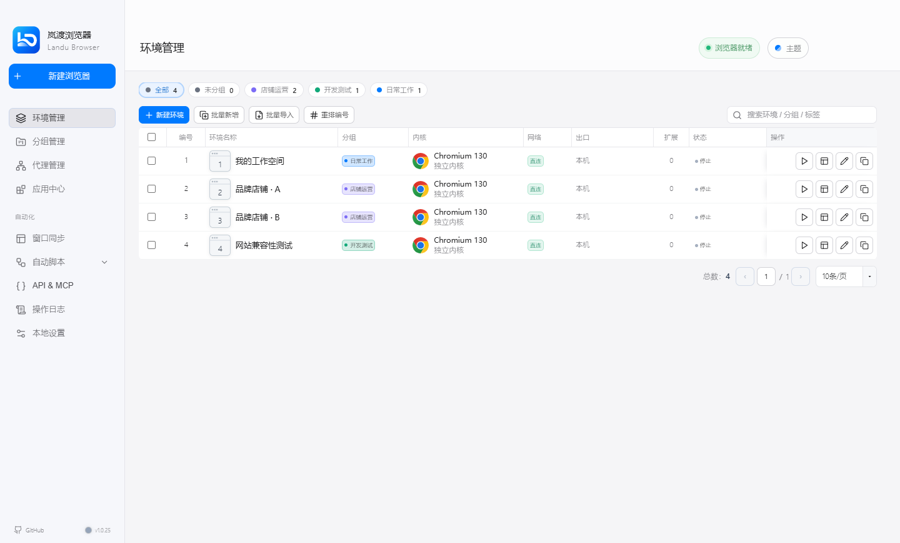

<div align="center">


# Landu Browser｜岚渡浏览器

**让每个浏览器环境，各有自己的空间。**

基于 [OpenBrowser](https://github.com/sheying2013/OpenBrowser) 二次开发的免费桌面浏览器环境管理工具。

[访问官网](https://heyinkcode.github.io/LanduBrowser/) · [使用指南](docs/GETTING_STARTED.md) · [开源与致谢](docs/OPEN_SOURCE.md) · [版本发布](https://github.com/heyinkcode/LanduBrowser/releases)

</div>

---

## 先说清楚：基于原作，免费使用

岚渡浏览器不是从零开发的浏览器内核。项目以 **OpenBrowser 原项目源码为底座**，保留原有的环境管理与业务逻辑，围绕中文使用体验、岚渡简约主题、界面排版和高分辨率适配等方面进行调整。

感谢原作者 **[sheying2013](https://github.com/sheying2013)** 及所有 OpenBrowser 贡献者。环境隔离、代理配置、指纹设置、自动化等核心能力来自原项目的工作，我们尊重并保留上游署名和许可证。

**岚渡浏览器软件免费使用，不以订阅或付费激活作为使用门槛。** 自行选择的代理、VPN、服务器等第三方服务费用另计，不包含在软件中，也不是使用软件的必选条件。

> **仓库与发行版**：`main` 分支存放官网、品牌资源和说明文档；Windows 客户端安装程序及对应应用源码包放在 [Releases](https://github.com/heyinkcode/LanduBrowser/releases)。本仓库的 `npm start` 预览官网，不启动桌面客户端。

## 免费下载 · v1.0.26

**普通用户推荐 [Windows 64 位完整版安装程序](https://github.com/heyinkcode/LanduBrowser/releases/download/v1.0.26/LanduBrowser-Windows-x86_64-with-kernel.exe)**，下载后双击安装，无需 Node.js 或开发工具。

| 文件 | 适合谁 |
| --- | --- |
| [完整版 EXE](https://github.com/heyinkcode/LanduBrowser/releases/download/v1.0.26/LanduBrowser-Windows-x86_64-with-kernel.exe) | 首次使用；内置独立内核和字体资源，体积较大。 |
| [轻量版 EXE](https://github.com/heyinkcode/LanduBrowser/releases/download/v1.0.26/LanduBrowser-Windows-x86_64-without-kernel.exe) | 已准备兼容内核的用户；未附带独立内核，首次运行需另外下载或配置。 |
| [对应应用源码 ZIP](https://github.com/heyinkcode/LanduBrowser/releases/download/v1.0.26/LanduBrowser-1.0.26-source.zip) | 开发者；含岚渡修改、原生组件源码和构建说明，不含内核与个人数据。 |
| [SHA-256 校验文件](https://github.com/heyinkcode/LanduBrowser/releases/download/v1.0.26/SHA256SUMS.txt) | 核对下载是否完整。 |

Windows 10/11 x64；尚未提供代码签名，可能出现未知发布者提示。请核对下载来源与校验值，不要关闭安全软件。详细步骤见 [下载、安装与更新](docs/DOWNLOADS.md)。

## 界面预览



*岚渡简约主题，使用示例环境数据展示，不包含真实用户账号。*

## 能做什么

| 功能 | 说明 |
| --- | --- |
| 独立浏览器环境 | 为不同工作空间使用独立 Chromium Profile，分别管理 Cookie、缓存与本地存储。 |
| 环境管理 | 使用分组、标签、批量操作管理多个环境，减少重复配置。 |
| 代理与区域配置 | 为环境配置 HTTP / HTTPS / SOCKS 代理、语言、时区等参数。代理服务需自行准备。 |
| 指纹参数 | 沿用原项目的 User-Agent、Canvas、WebGL、WebRTC 等配置能力。 |
| 应用与扩展 | 管理浏览器扩展，按工作场景组织使用。 |
| 自动化工具 | 沿用原项目的窗口同步、RPA、本地 API 与 MCP 接入能力。 |
| 岚渡简约主题 | 蓝白配色、统一控件、可调整表格列宽与更清晰的界面层级。 |

环境隔离用于管理工作空间，**不代表完全匿名，也不保证通过任何第三方检测、避免账号限制或适配所有网站**。具体能力与兼容性以实际版本为准。

## 客户端与获取方式

| 平台 | 当前说明 |
| --- | --- |
| Windows | 提供 v1.0.26 x64 完整版和轻量版安装程序；当前主要适配与验证平台。 |
| macOS / Ubuntu | 上游提供支持与打包路径；本仓库暂未提供岚渡版本安装包或完成独立验证。 |
| Android / iOS | 本仓库不提供手机客户端，也不提供手机远程管理端。 |

1. 先阅读 [使用指南](docs/GETTING_STARTED.md)。
2. 在 [Releases](https://github.com/heyinkcode/LanduBrowser/releases) 下载 EXE 并核对校验值，再按安装向导操作。
3. 需要岚渡客户端源码，请下载明确命名的 `LanduBrowser-1.0.26-source.zip`；GitHub 自动生成的 `Source code (zip)` 只对应官网分支。

## 文档导航

- [下载、安装与更新](docs/DOWNLOADS.md)：选择安装包、校验下载、升级与卸载。
- [使用指南](docs/GETTING_STARTED.md)：环境、代理、扩展、自动化、数据和常见问题。
- [开源说明与原作者致谢](docs/OPEN_SOURCE.md)：项目关系、MIT 许可证、免费范围与发布边界。
- [推荐网络服务（推广）](docs/RECOMMENDED_SERVICES.md)：岚渡云的入口及服务说明。
- [官网开发与维护](docs/WEBSITE.md)：本地预览、目录结构、GitHub Pages 发布与维护检查。

## 推荐网络服务（推广）

**需要单独的 VPN / 网络服务，可以了解 [岚渡云](https://app.landucloud.com)。**

入口：**[app.landucloud.com](https://app.landucloud.com)**

这是本项目维护者的推广推荐，并非 OpenBrowser 原作者的背书。岚渡云是可选的独立服务，套餐、价格与适用条件以服务页面为准；**不购买也不影响岚渡浏览器免费使用**。VPN 客户端与浏览器代理不是同一种配置方式，如何搭配请查看 [推荐服务说明](docs/RECOMMENDED_SERVICES.md)。

## 本地预览官网

需要 Node.js 18 或更新版本，无需安装依赖：

```bash
git clone https://github.com/heyinkcode/LanduBrowser.git
cd LanduBrowser
npm start
```

然后打开 `http://127.0.0.1:4173`。这只启动官网预览，**不启动桌面浏览器**。

## 反馈与贡献

欢迎在 [Issues](https://github.com/heyinkcode/LanduBrowser/issues) 提交排版、文档和使用问题。请描述系统、版本、复现步骤，并附上脱敏截图；不要上传账号密码、代理凭据、Cookie、验证码或完整环境数据。

## 许可证

上游 OpenBrowser 根许可证为 MIT。本仓库保留其 [LICENSE](LICENSE) 与贡献者署名，官网代码亦按 MIT 提供。客户端 Windows 后台输入组件含 AGPL-3.0 来源实现，对应许可及 C# 源码随发行版提供；Chromium、字体、扩展等适用各自条款。不要将所有第三方组件统称为 MIT，详见 [开源说明](docs/OPEN_SOURCE.md)。

**再次感谢 [OpenBrowser](https://github.com/sheying2013/OpenBrowser) 原作者及贡献者。岚渡基于原作继续改进，而非取代原作的贡献。**
